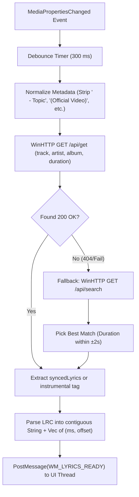

# AeroSync-Lite — Architecture & Market Analysis (v2)

> [!IMPORTANT]
> Numbers below are **engineering estimates** from how these stacks behave — not measured profiles of the named projects. Treat the teardown as "typical failure modes of each stack." Verify everything with a spike prototype, especially taskbar docking.

---

## 1. Competitive Teardown

| Stack | Likely RAM cost | Likely CPU cost |
|---|---|---|
| **Electron/Node** (Spicy Taskbar-style) | ~80–200 MB across main, renderer, GPU, and utility processes. Each carries V8, Blink, and a full Chromium runtime. | Transparent window forces compositing and GPU-process involvement. JS `setInterval` keeps waking the CPU. IPC between processes adds more wakeups. |
| **.NET/WPF** (MusicBar-style) | ~40–90 MB: CLR, JIT'd code, GC heaps, the WPF/MilCore stack, DirectX runtime. | `AllowsTransparency=true` uses a layered window with software-rendered composition. `DispatcherTimer` polling + GC pauses add jitter. WPF's render thread keeps animating even when nothing changes. |
| **Native C++** (TaskbarLyrics-style) | Naturally small, but often inflated by GDI+, bundled curl+OpenSSL, and full-resolution album art in memory. | Fixed-interval timer (16–100 ms) polling playback position + a full-window repaint on every tick even when the lyric line hasn't changed. |

**Shared mistakes across all three:**
- Poll instead of scheduling to the next lyric deadline.
- Repaint continuously instead of only when displayed content changes.
- Load GPU-backed rendering stacks to draw one line of text.
- Keep decoded art at full resolution.

---

## 2. Chosen Tech Stack

### Language: Rust
(`windows` crate, static CRT, `panic=abort`, `opt-level="z"`, LTO, no async runtime)

C++/WinRT would perform identically at runtime. Rust wins because this is an always-on process parsing untrusted network input (JSON and LRC), where memory safety matters.

**Rejected:**
- **Go:** runtime + GC + sysmon threads; floor ~8–10 MB with periodic wakeups
- **C#:** even NativeAOT with the WinRT projection carries more baseline than native
- **Python/Electron:** disqualified outright

### Rendering: CPU-rendered GDI into a 32-bit DIB, presented with `UpdateLayeredWindow` (per-pixel alpha)

Direct2D, DirectComposition, and Windows.UI.Composition all initialize a D3D device, which loads GPU user-mode driver DLLs and costs tens of MB for a one-line text widget. A layered window is composited by DWM, which is already running — marginal cost is a ~70 KB bitmap upload per lyric change.

**GDI alpha trick:** GDI text doesn't write alpha. Render white text on black with grayscale antialiasing (not ClearType), then derive alpha from luminance (`alpha = R channel`), premultiply the color. For a ~400×40 strip this is trivial.

**Complex scripts (Indic, Arabic, CJK):** GDI delegates to Uniscribe. If shaping quality falls short, lazy-load DirectWrite through its GDI-interop bitmap render target (software-only, no D3D) only for lines that need it.

### Other choices

| Concern | Choice | Reason |
|---|---|---|
| SMTC | `GlobalSystemMediaTransportControlsSessionManager` via WinRT | Completion handlers, not `.await` — no executor needed |
| HTTP | WinHTTP in sync mode on a worker thread | System DLL with Schannel TLS; no bundled TLS stack |
| JSON | Hand-rolled field extractor | LRCLIB responses are flat; avoids `serde` dep |
| Art decode | WIC, scaled to thumbnail size | System codec stack; source stream freed immediately |

### Realistic RAM budget

| Component | Private bytes |
|---|---|
| Static binary (Rust, stripped) | ~1.5 MB |
| WinRT / combase + SMTC DLL | ~3–4 MB |
| WinHTTP | ~2 MB |
| WIC | ~1–2 MB |
| Buffers (lyrics 5 KB + art 9 KB) | negligible |
| **Total** | **~5–9 MB** |

> [!NOTE]
> Task Manager's "Working Set" counts shared DLL pages. Track **private bytes** in Process Explorer for an honest comparison.

---

## 3. System Architecture

### Threading model

```mermaid
sequenceDiagram
    autonumber
    participant YTM as YouTube Music (Browser)
    participant SMTC as Windows SMTC
    participant Pool as Thread Pool (MTA)
    participant UI as UI Thread (STA / MsgWaitForMultipleObjectsEx)
    participant Worker as WinHTTP Worker Thread
    participant Timer as Hi-Res Waitable Timer
    participant DWM as DWM (Layered Window)

    YTM->>SMTC: Playback / Metadata change event
    SMTC->>Pool: Fire WinRT Completion Callback
    Pool->>UI: PostMessage (WM_SMTC_TRACK / TIMELINE / PLAYBACK)
    Note over UI: Extrapolate pos via GetSystemTimePreciseAsFileTime
    UI->>Worker: Spawn debounced worker thread (300 ms)
    Worker->>Worker: GET lrclib.net + Parse LRC
    Worker->>UI: PostMessage (WM_LYRICS_READY)
    Note over UI: Pre-render back buffer & compute next deadline
    UI->>Timer: SetWaitableTimerEx(due_duration)
    Timer-->>UI: Timer fires (Deadline reached)
    UI->>DWM: UpdateLayeredWindow(back_buffer)
    Note over UI: Microseconds presentation; re-arm for next line
```

**No mutexes.** The UI thread is the sole writer to `AppState`. WinRT/WinHTTP threads post data and exit.

---

## 4. Zero-Polling Sync Engine

SMTC doesn't stream position. It gives an *anchor* (`Position` + `LastUpdatedTime`) and `PlaybackRate`:

$$\text{pos\_now} = \text{anchor.position} + (\text{GetSystemTimePreciseAsFileTime} - \text{anchor.last\_updated}) \times \text{rate}$$

- `GetSystemTimePreciseAsFileTime` and `LastUpdatedTime` both use the wall-clock base — no QPC mapping error.
- Re-anchor on every `TimelinePropertiesChanged` and `PlaybackInfoChanged` event.
- Ignore events whose extrapolated position is within ~50 ms of the current anchor (avoids pointless re-arming).

---

## 5. Deadline-Scheduled Rendering

```rust
loop {
    // Sleeps with zero timers armed when paused/idle
    MsgWaitForMultipleObjectsEx(&[hi_res_timer], INFINITE, QS_ALLINPUT);
    drain_messages();         // SMTC snapshots, HTTP results, clicks, DPI, etc.

    if timer_fired || anchor_changed {
        let pos = now_pos() + user_offset;
        let idx = lines.index_at(pos);       // sequential ptr; binary search only after seek
        if idx != shown {
            present(back_buffer);            // UpdateLayeredWindow — microseconds
            swap();
            prerender(idx + 1);              // back buffer ready for next deadline
        }
        if playing {
            let due = lines[idx+1].t - pos;  // absolute from anchor; no drift
            SetWaitableTimerEx(hi_res_timer, due, tolerance≈10ms);
        } else {
            CancelWaitableTimer(hi_res_timer);
        }
    }
}
```

- Timer: `CreateWaitableTimerExW(..., CREATE_WAITABLE_TIMER_HIGH_RESOLUTION)` — ~1 ms accuracy, no global timer-resolution change.
- **Next line pre-rendered** after each present. At the deadline, only `UpdateLayeredWindow` runs.
- Wakeups ≈ lyric lines ≈ **0.2–0.3 Hz**. **Zero while paused.**
- CPU: rounds to **0.00%** in ETW context-switch traces.

---

## 6. State and Memory Hygiene

- **Lyrics:** one `String` + `Vec<(u32 ms, u32 offset)>` ≈ 5 KB per song.
- **LRC parsing:** multiple timestamps per line, `[offset:]` tag, word-level `<mm:ss.cc>` tags stripped.
- **Art:** one 48×48 premultiplied BGRA buffer ≈ 9 KB, with corner-rounding masks precomputed.
- **Idle:** after N minutes with no session, hide the window, free lyrics and art, block in `GetMessage`.

---

## 7. Lyrics Pipeline



SMTC exposes no URL — filter by `SourceAppUserModelId` for browser sessions.

---

## 8. Taskbar Docking

> [!WARNING]
> In Windows 11's **default centered layout**, the center is NOT empty — it's occupied by the icon cluster. Free regions are left of the icon cluster and between icons + system tray. The widget needs a configurable anchor.

| Approach | Pros | Cons |
|---|---|---|
| **A. `SetParent` into `Shell_TrayWnd`** (WS_CHILD + layered) | Inherits z-order, auto-hide, fullscreen hiding, taskbar movement. No z-order fights. | Undocumented shell internals. Must re-attach on Explorer restart. |
| **B. `TOPMOST\|TOOLWINDOW\|NOACTIVATE` floating window** | Only documented APIs. | Taskbar re-raises itself; must hook `TaskbarCreated` + `WM_SETTINGCHANGE` to re-assert z-order. Must handle fullscreen/auto-hide manually. |
| **C. DLL injection into `explorer.exe`** | Lowest footprint | Fragile, may crash shell, triggers AV. **Rejected.** |

**Implementation:** Mode A as primary, Mode B as fallback, behind one `OverlayWindow` interface.

**Free-space measurement:** one-shot UI Automation query on startup and on debounced shell events (`TaskbarCreated`, `WM_SETTINGCHANGE`, display/DPI change). **Never on a timer.**

---

## 9. Honest Limits of "Zero-Lag"

Your code adds essentially **no latency**, but sync accuracy is bounded by what the browser reports to SMTC. Chrome and YouTube Music update position on state changes — not continuously. Extrapolation + re-anchoring is the best available strategy. The **right-click ±100 ms offset control** covers Bluetooth latency and any residual drift.

---

## 10. Verification Plan

| Check | Method | Target |
|---|---|---|
| Wakeups | ETW/WPR context-switch count | < 1/second at idle, **0 while paused** |
| Memory | Private bytes in Process Explorer | < 10 MB |
| Regression | Wakeups/min + private-bytes gate in CI | — |

**Spike order (de-risk these before building anything else):**
1. Taskbar docking across Windows builds (22H2, 23H2, 24H2+)
2. SMTC position accuracy against audible playback
3. GDI alpha text quality with target scripts (CJK, Indic, Arabic)
