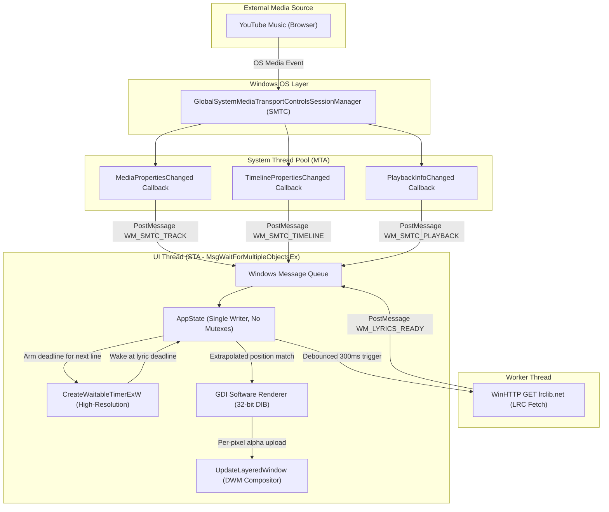

# AeroSync-Lite

> Hyper-lightweight Windows 11 taskbar widget displaying auto-synced lyrics from YouTube Music (browser).  
> Built in Rust — no runtime, no GC, no GPU driver overhead.

## RAM budget vs. the competition

| Tool | Stack | Idle RAM |
|---|---|---|
| Spicy Taskbar | Electron / Node | ~180–300 MB |
| MusicBar | .NET WPF | ~40–90 MB |
| TaskbarLyrics | C++ / Direct2D | ~15–30 MB |
| **AeroSync-Lite** | **Rust + GDI + WinRT** | **~5–9 MB** |

> Numbers are **private working set** (not Task Manager "Working Set" which counts shared DLL pages).

---

## Architecture



**Key design properties:**
- **No polling** — the timer fires only at lyric deadlines (~0.2–0.3 Hz). Zero CPU while paused.
- **Dead-reckoning position** — `pos = anchor_pos + (GetSystemTimePreciseAsFileTime − anchor_time) × rate`. Never calls SMTC for position inside the render path.
- **Pre-rendered back buffer** — the next lyric line is rendered after each present. At the deadline, only `UpdateLayeredWindow` runs. Critical-path latency ≈ microseconds.
- **GDI DIB + ULW** — no D3D device, no GPU driver DLLs. DWM composites the uploaded bitmap for free.
- **GDI alpha from luminance** — white text on black → `alpha = R channel`. Gives per-pixel AA without Direct2D.

---

## Requirements

- Windows 10 build 19041+ / Windows 11
- Rust toolchain (`rustup target add x86_64-pc-windows-msvc`)
- YouTube Music playing in any browser (Chrome, Edge, Firefox, etc.)

---

## Build

```powershell
# Release build (~1.5 MB binary, ~5–9 MB RAM)
cargo build --release

# Or debug (larger, unstripped)
cargo build
```

Output: `target\release\aerosync-lite.exe`

---

## Run

```powershell
.\target\release\aerosync-lite.exe
```

The widget appears in the right portion of the taskbar (left of the system tray).

---

## Usage

| Action | How |
|---|---|
| See current lyric | Automatic — synced every lyric deadline |
| Play / Pause | Left-click the album art thumbnail |
| Adjust sync offset | Right-click → `+100 ms` / `-100 ms` |
| Quit | Right-click → Quit |

---

## Project structure

```
AeroSync-Lite/
├── src/
│   ├── main.rs       # Entry point: message loop, WNDPROC, timer
│   ├── state.rs      # AppState, TimeAnchor, WM_APP IDs, dead-reckoning
│   ├── smtc.rs       # WinRT SMTC event handlers → PostMessage
│   ├── lyrics.rs     # WinHTTP fetch, LRC parser, O(log n) index_at
│   ├── render.rs     # GDI DIB, alpha-from-luminance, UpdateLayeredWindow
│   ├── taskbar.rs    # Shell_TrayWnd docking (SetParent + TOPMOST fallback)
│   └── art.rs        # WIC decode, 48×48 scale, corner-rounding mask
├── Cargo.toml        # Only 1 dep: `windows` crate
├── .cargo/config.toml # Static CRT
├── build.rs          # Manifest embedding (DPI, UAC)
├── manifest.xml      # Per-monitor DPI v2, asInvoker
└── archive/          # Previous Python prototype (for reference)
```

---

## Troubleshooting

| Symptom | Fix |
|---|---|
| Widget not visible | Ensure YouTube Music is actively playing in a browser |
| "No lyrics found" | Track may not be in LRCLIB; check [lrclib.net](https://lrclib.net) |
| Widget behind taskbar | Do not run as Administrator — UAC elevation breaks TOPMOST across integrity levels |
| Lyrics out of sync | Right-click → adjust offset in ±100 ms steps |
| Explorer restart loses widget | The `TaskbarCreated` message re-attaches automatically |

---

## Technical notes

### Why not Direct2D?
D3D device init loads GPU user-mode driver DLLs: adds 15–30 MB to private working set for a one-line text widget. GDI + DWM compositing costs zero marginal GPU DLL overhead.

### Why not async (tokio)?
The whole app needs two external interactions: SMTC events (WinRT callbacks, already thread-pool) and one HTTP call per track (a worker thread). An async executor would add ~100 KB binary and ~1 MB RAM with no benefit here.

### Why static CRT?
No MSVCRT.dll dependency; the binary is self-contained. The size penalty is ~40 KB at `opt-level="z"` with LTO — negligible.

### Taskbar docking
Primary mode: `SetParent(our_hwnd, Shell_TrayWnd)` — inherits z-order, auto-hide, and taskbar movement with no z-order fights. Fallback: floating `WS_EX_TOPMOST` window that re-raises on `TaskbarCreated`. Both are behind one `OverlayWindow` interface.

### Sync accuracy
SMTC reports position only on state changes. We extrapolate with `GetSystemTimePreciseAsFileTime` (wall-clock base matches SMTC's `LastUpdatedTime`). Re-anchor on every `TimelinePropertiesChanged` event. User offset (right-click menu) corrects Bluetooth latency.
