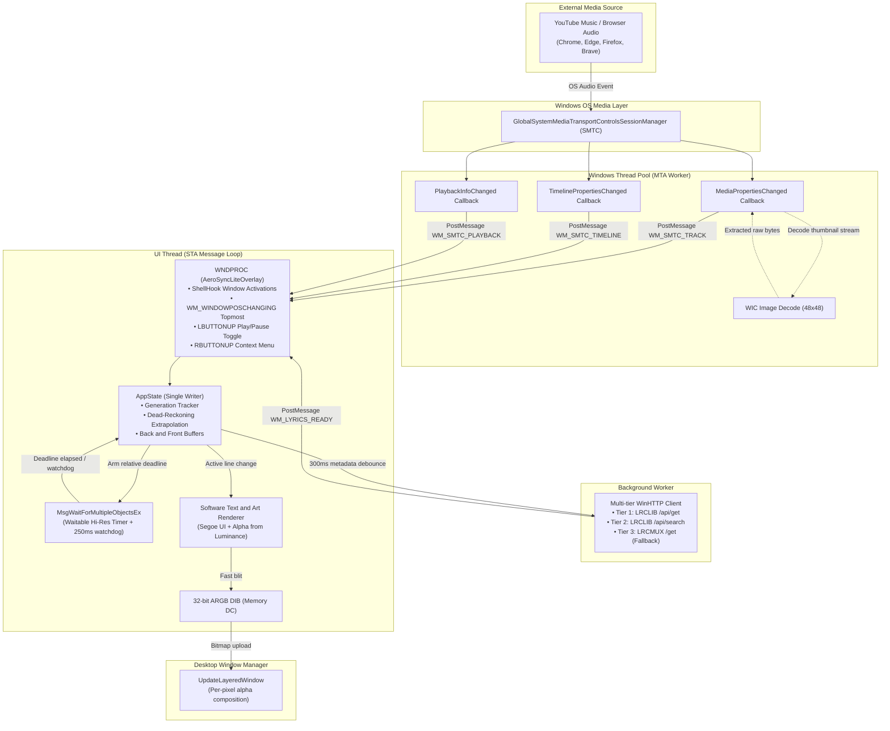

# AeroSync-Lite: Technical Architecture & Systems Design

This document details the low-level systems architecture, concurrency model, memory design, and rendering pipeline of **AeroSync-Lite**.

---

## 1. Design Philosophy

Most desktop lyric widgets and taskbar accessories suffer from severe resource bloat:
- **Chromium/Electron wrappers** consume 180–300 MB of RAM across multiple processes for displaying a single line of text.
- **WPF / .NET applications** require 40–90 MB of memory for the CLR runtime, JIT compiler, and MilCore composition stack.
- **Direct2D / DirectComposition** solutions pull in DirectX/D3D runtime DLLs and GPU user-mode drivers (~15–30 MB private working set).
- **Fixed-interval polling loops** (16–100 ms) continuously wake the CPU and trigger unnecessary GPU redraws even when paused or when text is static.

**AeroSync-Lite** is designed from bare metal in **Rust** to achieve:
1. **Near-Zero CPU Usage (0.00% when idle/paused)** via deadline-driven wakeups.
2. **Ultra-Low Memory Footprint (~5–7 MB Private Working Set)** by eliminating runtimes, garbage collection, and GPU driver overhead.
3. **Sub-millisecond Render Latency** via CPU-rendered 32-bit DIBs presented directly to the Desktop Window Manager (DWM) with `UpdateLayeredWindow`.

---

## 2. Competitive Memory & Resource Teardown

| Architectural Layer | Electron / Web | WPF / .NET | Native C++ (Direct2D) | AeroSync-Lite (Rust + GDI) |
|---|---|---|---|---|
| **Runtime / GC** | V8 + Node (~50 MB) | .NET CLR (~30 MB) | None (0 MB) | **None (0 MB, Static CRT)** |
| **Graphics Stack** | Chromium Compositor (~80 MB) | MilCore / D3D (~25 MB) | Direct2D / D3D (~20 MB) | **CPU GDI DIB (~0.2 MB)** |
| **Window Compositing** | Transparent HWND + GPU blit | Layered window / D3D | DirectComposition surface | **UpdateLayeredWindow (DWM)** |
| **Media Interception** | WebSockets / Extensions | WinRT projection | WinRT C++/WinRT | **WinRT (Raw Handlers, no async)** |
| **Networking Stack** | Node fetch / libuv | HttpClient (Schannel) | WinHTTP or libcurl+OpenSSL | **WinHTTP (Zero bundled TLS)** |
| **Typical Private RAM** | **180–300 MB** | **40–90 MB** | **15–30 MB** | **~5–7 MB** |

---

## 3. System Architecture Diagram

---

## 4. Core Subsystems

### 4.1. Single-Threaded UI & Concurrency Model
AeroSync-Lite executes strictly on a **single owned UI thread**:
- **Zero Locks / No Mutexes:** `AppState` is solely accessed by the UI thread inside the message loop.
- **Thread Pool Callbacks:** SMTC WinRT events (`MediaPropertiesChanged`, `PlaybackInfoChanged`, `TimelinePropertiesChanged`) fire on MTA thread-pool threads. Handlers immediately snapshot primitive data onto the heap, wrap it in a pointer, and dispatch via `PostMessageW` (`WM_SMTC_*`). The thread pool thread exits immediately.
- **Network Isolation:** WinHTTP queries run in isolated background threads and report back via `WM_LYRICS_READY` carrying an incrementing generation counter. Stale network responses from skipped tracks are dropped instantaneously without locking.

### 4.2. Zero-Polling Sync Engine (Dead-Reckoning)
Windows SMTC does not stream continuous playback position updates. Browser playback engines only push timeline events on state shifts (play, pause, track change, or seek). 

AeroSync-Lite achieves sub-millisecond sync without polling by computing position on demand:

$$
\text{pos}(t) = \text{pos}_{\text{anchor}} + (t_{\text{now}} - t_{\text{anchor}}) \times \text{rate} + \text{offset}
$$

Where:
- `t_now` is read from `GetSystemTimePreciseAsFileTime` (wall-clock 100 ns FILETIME).
- `t_anchor` is `TimelineProperties.LastUpdatedTime` (also wall-clock FILETIME).
- `rate` is the playback speed (typically `1.0`).
- Using matching wall-clock epochs prevents drift between QueryPerformanceCounter (QPC) and system wall-clock time.

### 4.3. Deadline-Scheduled Wakeup Loop
Instead of running a 60 Hz animation loop or a 100 ms polling timer:
1. `index_at(pos)` determines the current lyric line.
2. `next_start_ms(idx)` computes the timestamp of the next line.
3. A Windows high-resolution waitable timer (`CreateWaitableTimerExW` with `CREATE_WAITABLE_TIMER_HIGH_RESOLUTION`) is armed for the exact remaining duration:

$$
\Delta t = t_{\text{next}} - \text{pos}(t)
$$

4. The thread enters kernel sleep via `MsgWaitForMultipleObjectsEx`:
   - **While Playing:** Arms deadline timer with a 250 ms maximum sleep watchdog to guarantee prompt re-syncing and taskbar Z-order enforcement.
   - **While Paused:** Cancels all timers and sleeps with `INFINITE` timeout. CPU utilization is literally **0.00%**.

### 4.4. Software CPU Rendering & Alpha-from-Luminance
Direct2D and Direct3D require initializing DirectX runtimes, allocating GPU command queues, and mapping device contexts. For a ~400×40 pixel taskbar strip, this overhead is counterproductive.

AeroSync-Lite uses CPU-rendered GDI into a 32-bit ARGB DIB:
- **Subpixel Antialiasing Simulation:** GDI standard text rendering (`DrawTextW`) does not natively write alpha channels. AeroSync-Lite renders light text onto a black background with grayscale smoothing.
- **Luminance Pass:** Pixel alpha is derived directly from luminance (`alpha = R_channel`).
- **Premultiplication:** RGB values are premultiplied by the derived alpha channel in a single vectorized pass:

$$
\text{RGB}_{\text{premult}} = \frac{\text{RGB} \times \alpha}{255}
$$

- **Zero Copy DWM Presentation:** `UpdateLayeredWindow` passes the premultiplied DIB directly to the Windows Desktop Window Manager. DWM handles GPU composition at screen refresh rate.

### 4.5. Windows 11 Taskbar Docking & Z-Order Persistence
Windows 11 restricts foreign processes from making `Shell_TrayWnd` a parent (`WS_CHILD`) or owner via cross-process UIPI controls.

AeroSync-Lite solves this via an autonomous floating topmost architecture:
- **Window Styles:** `WS_POPUP | WS_VISIBLE` with `WS_EX_LAYERED | WS_EX_TOOLWINDOW | WS_EX_TOPMOST | WS_EX_NOACTIVATE`.
- **Z-Order Pinning:**
  1. `RegisterShellHookWindow` registers the overlay window to receive shell activation messages (`WM_SHELLHOOK`). Whenever another window or the taskbar is clicked, the overlay is immediately re-raised with `SetWindowPos(HWND_TOPMOST, SWP_NOACTIVATE)`.
  2. `WM_WINDOWPOSCHANGING` intercepts any Z-order demotion, clearing `SWP_NOZORDER` and forcing `hwndInsertAfter = HWND_TOPMOST`.
  3. `WM_MOUSEACTIVATE` returns `MA_NOACTIVATE` so clicking the play/pause button does not steal focus from your active workstation apps.

### 4.6. Multi-Tier Resilient Lyric Sourcing
Lyrics are parsed from synchronized LRC formats using a multi-tiered fallback strategy:
1. **Tier 1 (LRCLIB Exact):** Queries `https://lrclib.net/api/get` with track title, artist name, album name, and duration.
2. **Tier 2 (LRCLIB Fuzzy Search):** If exact lookup returns 404/502, queries `https://lrclib.net/api/search?q=...` and selects the best duration match (within ±4 seconds).
3. **Tier 3 (LRCMUX Aggregator Fallback):** If LRCLIB is unavailable, automatically falls back to `https://api.lrcmux.dev/get` with title and artist parameters.
